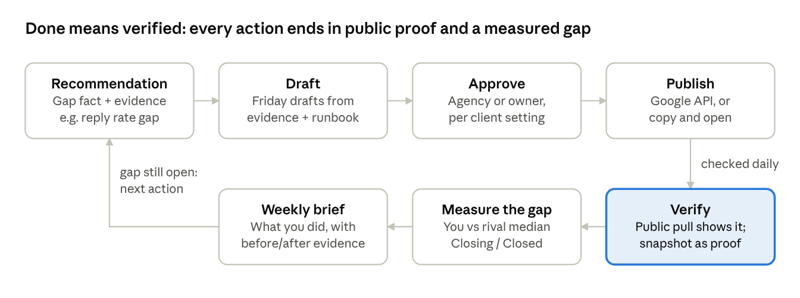

# Rival Monday — Act on a Recommendation: Close-the-Gap Proposal

2026-10-29 · **Status: deferred to Rival Monday 2.0** (owner, 2026-10-29). Not scheduled; when picked up, start with `/rm-kickoff` and treat the open decisions below as the brainstorm input. Source doc: https://claude.ai/artifact/216j3XDxmMpNR13wTFwQTY

## Summary

Rival Monday should turn every recommendation into an **action**: a drafted, approvable piece of work (a review reply, a profile edit, a Google post, a citation fix) that the agency or the owner publishes from inside the app, and that we then **verify from public data** and score against the rival gap that caused it.

Today a recommendation is a title, a rationale with evidence, effort/impact, an owner and a status (`todo / in_progress / done / dismissed`). The user must leave the app to do the work, and "done" is a click, not a fact. The product comparison of 2026-10-28 named exactly where rivals are stronger: RivalMappd writes review responses, BrightLocal owns citations, and Local Falcon's agent acts on Google Business Profile (GBP) and reviews.

The proposal adds one loop, built once and reused by four action kinds:

1. **Draft**: Friday prepares the work from the recommendation's evidence and the client's runbook.
2. **Approve**: the right person (agency or owner, per client setting) edits and approves.
3. **Publish**: one click through a connected Google profile, or a guided "copy and open" hand-off when no connection exists.
4. **Verify**: our existing collectors re-read the public profile; the action becomes *Verified* only when the change is visible, with a snapshot as proof.
5. **Measure**: the gap metric that triggered the recommendation (reply rate, review pace, profile completeness, citation consistency) is tracked against the rival median and reported in the brief.

**Headline decisions for the owner** (details in the last section):

- Build the loop **copy-first** (no Google dependency) and add direct publishing when GBP API access is approved.
- Drafts are **never auto-published**: a human approves every outward change.
- Citations start as an **audit plus guided fixes**; paid listing submission is a later, credit-priced add-on.
- The Google consent screen must not say "Rival Monday" for white-label clients; this ties direct publishing to the neutral domain work in 13a2.

## Where we are today

Most of the inputs an action needs already exist on `main`; what is missing is the write path to Google and the proof that the work happened.

**What we have**

| Building block | Where | What it gives the action layer |
| --- | --- | --- |
| `recommendation` table | `@cs/db` schema/briefs.ts | Title, rationale, `evidence_ids`, `event_ids`, `move_id`, `playbook_id`, effort, impact, owner (client/agency), status, due date, source (brief/move/ask/mcp) |
| Self-rules + scorecard | `@cs/engine` briefs/self-rules.ts, scorecard.ts | The gap facts: `reply_rate_gap`, `review_velocity_gap`, `rating_gap`, `profile_gap`, `map_visibility_gap`, `topic_weakness`, `rival_only_advertiser`; metrics `rating`, `reviews90d`, `replyRate`, `mapTop3Share`, ads |
| Runbook plays | `@cs/engine` runbook/, pack YAML | `reply_to_reviews`, `ask_for_reviews`, `fix_top_complaint`, `complete_profile`, `improve_map_rank`, plus move plays (promo blitz, territory, new service) |
| Reviews with owner answers | `@cs/collectors` reviews/upsert.ts | Own and rival reviews incl. `owner_answer` and `owner_answered_at`; reviewer names pseudonymised (HMAC) |
| GBP snapshots + differ | `@cs/engine` structured/gbp.ts | Categories, services, hours, title, status, phone, URL for self and rivals; changes become events |
| Friday confirm-before-write | `@cs/ask` actions.ts | A write the model proposes is stored as `proposed` and runs only when the user confirms |
| Verifier | `@cs/engine` briefs/verify.ts | Two-layer sentence check (rules + Jev at τ 0.85): no evidence, no claim |
| Evidence store, cost guards, plan features | R2, 7b, `hasChannel` | Snapshots for proof, credits per AI task, plan gating |

**The gaps the product comparison found**

| Rival product | Better at (2026-10-28 comparison) | Our answer in this proposal |
| --- | --- | --- |
| RivalMappd | Done-for-you review responses (Growth: up to 10/month) | Unlimited drafted replies, owner-approved, benchmarked against rivals' reply rate |
| Local Falcon | An agent that acts on GBP and reviews | Friday drafts; publish via the GBP connection; verification + evidence, which they do not state |
| BrightLocal | Citations, reputation tools | Citation audit benchmarked against rivals, guided fixes, re-check; submission later |
| Birdeye | Full reputation suite | Not matched on breadth; matched on the competitor-driven "why" |

**What is missing**

- No write path to any Google surface; no OAuth connection to a client's Business Profile.
- No citation data at all (neither self nor rivals).
- "Done" is self-reported; nothing checks that a reply or edit went live.
- Recommendations have no gap metric or target attached, so briefs cannot say "you closed it".
- Reply text the client would publish is not drafted anywhere; owners write it from scratch.

## The action loop

Every action, whatever its kind, runs the same seven steps; only *Verify* is new as a concept, and it is what lets Rival Monday say "done" with evidence instead of a checkbox.

A recommendation can hold several actions (e.g. 14 review replies). Action statuses: `draft → awaiting_approval → approved → published → verified`, with `not_verified`, `failed` and `dismissed` as exits. The recommendation's own status follows its actions: *in progress* while any is open, *done* when all are verified, and its gap status (*Closing / Closed / Stalled*) is tracked separately.

## Action types in depth

Five action kinds cover every play in today's runbooks; the first three close the gaps the comparison named, and all five share one lifecycle.

| Kind | Triggered by (rule / play) | Publish path | Verified by |
| --- | --- | --- | --- |
| `review_reply` | `reply_rate_gap` / `reply_to_reviews`; `rating_gap` / `fix_top_complaint`; any new 1–3★ review | GBP API reply, or copy + open the review in Google | Next review pull shows `owner_answer` on that review |
| `gbp_profile_edit` | `profile_gap` / `complete_profile`; `map_visibility_gap`; move `new_service_line` | GBP API location patch, or guided edit | Next GBP snapshot shows the field |
| `gbp_post` | Moves `promo_blitz`, `price_change`, `territory_expansion`; `topic_strength` / `promote_strength` | GBP API local post, or copy + open | Post visible on the public profile (snapshot) |
| `citation_fix` | New rule `citation_gap` / play `fix_citations` | Guided: prefilled NAP block + claim link per directory | Re-check of that directory listing |
| `review_request_kit` | `review_velocity_gap` / `ask_for_reviews` | Kit: review link, QR code, SMS/email text; optional webhook to the agency's CRM | `reviews90d` pace over the next 30–60 days |
| `checklist` | Every other play (ads, pricing, website) | Steps, assignee, due date, proof link | Our web/ads monitors on the client's own assets, else attested |

### 1. Review replies (closes RivalMappd and Local Falcon)

The reply inbox lists the client's own unanswered reviews, newest and lowest-rated first, with a Friday draft on each.

- **Benchmark first.** The recommendation states the gap from data we already hold, for example: "You replied to 22% of reviews in the last 90 days; your top rivals' median is 81% and they reply in a median of 2 days." Rival replies are evidence, so the claim cites them.
- **Drafting.** A new AI task `review_reply_writer` gets the review text (through `redactForModel`), the star rating, the review's topics (from `review_analysis`), the runbook's reply voice and the client profile. It returns one reply of 40–120 words. The verifier rejects any reply that states a fact (price, warranty, guarantee, date) not in the client profile or runbook.
- **Vertical guardrails, enforced in code, not just in the prompt.** Dental: never confirm that the reviewer is a patient, never mention treatment, appointments or records (HIPAA; US practices have been fined for exactly this). All verticals: no offers in exchange for edits, no arguing about facts, no personal data, an offline contact line for 1–2★.
- **Rival style as input.** Friday can say what rivals' replies do (length, personal sign-off, invitation to call) from their `owner_answer` texts, aggregated, never copied.
- **Batch approve.** Agencies approve 20 replies in one pass; owners approve from the weekly email or a phone notification.
- **Speed.** With a GBP connection we read new own reviews from the API hourly instead of waiting for the vendor pull; a 1–2★ review gets a draft within the hour.
- **Measures:** `replyRate` and median reply time, you vs rival median.

### 2. Google Business Profile edits (closes Local Falcon)

Friday proposes a **field-by-field diff** against what top rivals show, each line with its evidence:

- Categories rivals use that you lack (e.g. 4 of 5 rivals list "Water heater installation service").
- Services, hours (incl. holiday hours), description, attributes, opening date, website and booking links.
- Photo count and recency, and post cadence ("rivals posted 6 times in 30 days, you 0").

Rules: we never propose a change to **business name, address or primary phone** (these can trigger Google re-verification and suspensions, and keyword-stuffed names break Google's guidelines). Category changes carry a warning. Each line is approved separately.

### 3. Google posts

A move such as a rival's promo blitz yields a drafted counter-post (an update or offer post) that follows the play ("counter without discounting everything"). The verifier blocks any price or offer the client has not confirmed; the approver fills those fields.

### 4. Citations (closes BrightLocal)

This is new data. A monthly **citation audit** checks the client and its top rivals on 30–50 directories per vertical (core: Google, Apple Business Connect, Bing Places, Yelp, Facebook, BBB, Nextdoor; HVAC/plumbing: Angi, HomeAdvisor, Thumbtack, Porch; dental: Healthgrades, Zocdoc, WebMD, Vitals).

- Per directory: listed or not, NAP (name, address, phone) match vs the GBP record, URL, last checked, a snapshot.
- Benchmark, for example: "Your top rival is listed on 34 of 40, you on 19; 6 of yours show an old phone number."
- Action per directory: a prefilled NAP block to copy, the claim or edit link, a short how-to; then a re-check.
- Collection respects our crawler rules (honest UA, robots, ≥ 3 s per host, the SSRF guard). Where a directory disallows us, we use the vendor search route only.

### 5. Review request kit

For `review_velocity_gap` we give the owner the direct Google review link, a QR code (PDF for the counter or the van), and SMS/email templates in the runbook voice. Google forbids review gating and incentives, so the kit asks every customer and never filters by sentiment. Sending messages to customers ourselves (TCPA, CAN-SPAM, consent) is out of scope for v1; an optional webhook hands the template to the agency's CRM.

### 6. Checklist (everything else)

Ads, pricing and website plays become a short checklist with an assignee and due date. If we monitor the client's own site or ads, the matching change auto-verifies it; otherwise the person attaches a proof link and it shows as *Done (not verified)*.

## Who does what

The agency decides, per client, who approves and who publishes; Friday drafts but never publishes on its own.

**Approval mode** (new client setting, default *Agency publishes*):

| Mode | Who approves | Who publishes | Fits |
| --- | --- | --- | --- |
| Agency publishes | Agency staff | Agency staff | Managed-service clients (the agency's main offer) |
| Owner approves | Client owner | Agency staff, or auto-publish on approval | Owners who want a say on replies |
| Owner does it | Client owner | Client owner | Self-serve clients, platform pool |

**Permissions** (reuse the existing tiers; tools decide, pages only hide):

| Role | Draft / edit | Approve | Publish | Connect Google |
| --- | --- | --- | --- | --- |
| Agency admin | yes | yes | yes | yes |
| Agency staff (`manage`) | yes | yes | yes | no |
| Client owner | yes | yes | in *Owner does it* / *Owner approves* | yes (they own the profile) |
| Client viewer | no | no | no | no |
| Friday (Ask, MCP) | proposes drafts | no | no | no |
| Operator (support session) | read only | no | no | no |

**Rules**

- Every outward change needs a named human approval; the approver and the exact text are kept in the audit log and `feedback`.
- A recommendation's existing `owner` (client/agency) sets the default assignee of its actions.
- Agencies see one **Approvals** queue across clients (like the brief approval queue); owners get one weekly digest of pending drafts plus an immediate notice for 1–2★ reviews.
- **White-label:** drafts, emails, the review kit and the QR PDF carry the agency's brand only. `upsell_tag` stays off every client-facing payload. Nothing in a published reply or post may name the agency or Rival Monday unless the runbook says so.

## Integrations

Direct publishing depends on Google approving our Business Profile API access, so every action must also work without it; the GBP connection is an upgrade, not a requirement.

### Google Business Profile APIs

| What | Endpoint | Used for |
| --- | --- | --- |
| Reply to a review | `PUT mybusiness.googleapis.com/v4/{accounts/*/locations/*/reviews/*}/reply` ([reference](https://developers.google.com/my-business/reference/rest/v4/accounts.locations.reviews/updateReply)) | `review_reply` publish |
| List own reviews | v4 `accounts.locations.reviews.list` | Hourly own-review pull, real reviewer display names kept out of storage |
| Edit profile fields | Business Information API v1 `locations.patch` (update mask per field) | `gbp_profile_edit` |
| Create a post | v4 `accounts.locations.localPosts.create` | `gbp_post` |
| Accounts and locations | Account Management API | Picking the location at connect time |

Scope: `https://www.googleapis.com/auth/business.manage`. The v4 reply method shows no deprecation notice (reference last updated 2026-04-07); the v1/v4 split for posts and locations must be re-checked at kickoff against Google's deprecation schedule.

**Access gate** ([prerequisites](https://developers.google.com/my-business/content/prereqs)): a Google Cloud project and an organisation account; an application for Basic API Access from an address that is owner/manager on a GBP that is verified and active for 60+ days and has a website. Until approval the quota is 0 QPM; approved projects get 300 QPM. The sensitive scope also needs Google's OAuth app verification (privacy policy, homepage, demo video).

**Connect flow**

1. Agency admin or client owner clicks *Connect Google profile* on Client settings › Connections.
2. Google consent for `business.manage`; we receive a refresh token.
3. They pick the location; we match it to the client's GBP record (place id / CID) and refuse a mismatch.
4. We store the token encrypted (envelope key per environment; never in logs: `redactForLog`), with scopes, connected-by and status.
5. A failed refresh marks the connection *Needs reconnecting*, notifies the connector, and drops pending publishes back to copy mode.

**White-label problem.** Google's consent screen shows the OAuth app name and domain. A single Rival Monday app would name us to every client, which our billing rule forbids. Options: (a) one app under the neutral brand from 13a2 (recommended); (b) let large agencies bring their own Google Cloud project and credentials (later, enterprise). This makes 13a2 a dependency of direct publishing, not of the copy-first release.

**Fallback ("copy and open").** Without a connection, *Publish* copies the approved text and opens the exact review or edit page in Google in a new tab; the user marks it posted; verification then confirms it from public data. This ships first and keeps working for clients who never connect.

### Citation data

- Discovery: the vendor SERP route we already use (DataForSEO) for "name + phone" and "name + city" per directory domain, at a fixed cap per audit.
- Reading listings: our own fetcher through the SSRF guard, robots rules and per-host pacing; a directory that disallows us is checked through search results only.
- Submission partners (aggregators or a listings API) are a phase-2 decision; any paid submission is charged in credits, never usage-billed to the tenant.

### Other surfaces (later)

Apple Business Connect and Bing Places offer APIs or bulk tools for verified partners; they follow the GBP pattern once it works. Yelp and Facebook replies stay copy-and-open.

## Measuring the gap closed

An action counts as done only when public data shows it, and a recommendation counts as won only when its gap metric reaches the rival median; both are evidence-backed claims in the brief.

**Two levels of proof**

| Level | Question | Source | Result |
| --- | --- | --- | --- |
| Action verified | Did the change go live? | Next review pull / GBP snapshot / directory re-check, within a verify window (replies 3 days, profile 7 days, citations 45 days) | *Verified* with a snapshot, or *Not seen yet* → *Not verified* after the window, with a nudge |
| Gap closed | Did it move the metric that caused the recommendation? | Scorecard metric for that rule, you vs rival median, from the baseline at creation | *Closing* (moving toward the median), *Closed* (at or past it), *Stalled* |

**Gap metric per rule** (stored on the recommendation at creation as `gap_metric`, `baseline`, `target`):

| Rule | Metric | Target |
| --- | --- | --- |
| `reply_rate_gap` | `replyRate` (90 d) + median reply days | Rival median |
| `review_velocity_gap` | `reviews90d` | Rival median |
| `rating_gap` | `rating` + share of 1–2★ on the weak topic | Rating trend up; topic share at rival median |
| `profile_gap` | Profile completeness score (new, from fields we already snapshot) | Top-rival score |
| `map_visibility_gap` | `mapTop3Share` | Rival median (slow; reported, never promised) |
| `citation_gap` (new) | Listed + NAP-consistent share of the vertical's directory set | Top-rival share |

**Where it shows**

- **Brief:** a new "What you did" block lists verified actions and any gap that moved, each sentence citing the before and after evidence. Quiet weeks gain it too, so the brief shows progress even when rivals are silent.
- **Scorecard:** each tile gets the open action count and "since you started acting" delta (the existing `deltaSinceStart` already holds the baseline).
- **Agency portfolio:** actions verified this month and gaps closed per client: the agency's proof of work for renewals.

**Honesty rules**: we never claim a ranking or revenue result caused by an action; we report the metric and the date. A gap that closed while no action ran is reported as closed, not as a win.

## UX

Actions live where the recommendation already is, so no new top-level area is needed: the Recommendations page becomes the place to act, plus one reply inbox and one agency approvals queue.

**Client view (`/c/<id>/…`)**

| Surface | Change |
| --- | --- |
| Recommendations (`/recommendations`) | Each row shows its gap line ("Reply rate 22% → rivals 81%" style, from the stored metric), a progress chip (*Closing / Closed / Stalled*) and a primary **Start** button that opens the action sheet. Filters: *Needs you*, *Waiting on approval*, *Verified*. |
| Action sheet (right `ListDetailSheet`) | Evidence on the left (rival snapshot, your snapshot), the draft on the right; Edit, Approve, Publish (or *Copy and open in Google*), Dismiss with reason. Shows who approved and when. |
| Reviews › **Reply** tab (`/reviews?tab=reply`) | Inbox of own unanswered reviews with drafts; multi-select **Approve selected** (`BulkBar`); per-review rival benchmark line on top. |
| Overview | One "To do" section: count of drafts waiting for the viewer, newest 1–2★ review. |
| Settings › **Connections** | Connect / reconnect Google profile; status; who connected it. |
| Settings › Runbook | New "Reply voice" and "Post voice" items (tone, sign-off, phone line, words to avoid), tailored per client like other runbook items. |
| Citations (new page under Rankings, or a tab) | Directory grid: you vs top rivals, listed / NAP match / not listed, each with *Fix* (opens a `citation_fix` action). |

**Agency view**

- `/agency/approvals`: all drafts waiting for agency approval across clients, grouped by client, oldest first; bulk approve.
- Portfolio: "Actions verified (30 d)" and "Gaps closed" columns.

**Friday and MCP**

- Friday starters: "Draft replies to my unanswered reviews", "What should I change on my Google profile?", "Where am I missing listings?".
- Friday's drafts arrive as the existing confirm cards; confirming saves a *draft action* (never a publish). Publishing is a separate human click in the app.
- MCP exposes read tools (`list_actions`, `get_action`, `get_citation_audit`) and the draft write (`draft_action`) under the same confirm rules; no publish tool over MCP in v1.

**Email and phone**

- 1–2★ review: immediate notice with the draft and *Approve* / *Edit in app* links (signed, single-use).
- Weekly brief: a "Waiting on you" count with a link to the queue.

All pages follow the design system (one white sheet, sections before cards, `PageHeader` with a help key and guides) and every new copy line goes through `pnpm copy:review`.

## Architecture and data model

One new `action` table, a connection table and a citation table carry the feature; everything else reuses existing tools, jobs, the verifier and the evidence store.

**New tables** (each gets RLS, a `TABLE_CLASS` entry and isolation-world rows)

| Table | Key columns | Notes |
| --- | --- | --- |
| `action` | `id`, tenant, `recommendation_id` (nullable: a review alert can create one), `kind`, `status`, `target` jsonb (review id / field / directory), `draft` jsonb, `final` jsonb, `assignee_role`, `approved_by`, `approved_at`, `published_by`, `published_at`, `publish_mode` (`api` / `copy`), `external_ref`, `verify_due_at`, `verified_at`, `verify_evidence_id`, `error`, `cost_credits` | Statuses: `draft → awaiting_approval → approved → publishing → published → verified`, plus `not_verified`, `failed`, `dismissed`. Unique per (`kind`, `target`) while open. |
| `gbp_connection` | `client_id` (unique), `google_account_email`, `location_name`, `place_id`, `scopes`, `token_ciphertext`, `status`, `connected_by`, `last_ok_at` | Service-only token column; app role sees status fields only. Archived client → token deleted. |
| `citation_listing` | tenant, `competitor_id` (self or rival), `directory`, `url`, `listed`, `nap_match` jsonb, `evidence_id`, `checked_at` | Directory catalogue per vertical lives in the pack YAML. |
| `recommendation` (alter) | + `gap_metric`, `gap_baseline`, `gap_target`, `gap_status` | Filled at creation from the self-rule finding. |

**Tools** (`@cs/tools`; web writes through `runTool`, every one audit-logged with an `ISOLATION_FIXTURES` entry)

- Reads: `list_actions`, `get_action`, `list_reply_inbox`, `get_citation_audit`, `get_gbp_connection`.
- Writes: `draft_action`, `update_action_draft`, `approve_action`, `publish_action`, `mark_action_posted` (copy mode), `dismiss_action`, `connect_gbp` / `disconnect_gbp`, `set_approval_mode`.
- Out-of-scope client → `not_found`; page refusals → 404.

**Jobs** (worker, pg-boss; paid work gated by `clientWorkAllowed`)

| Job | When | Does |
| --- | --- | --- |
| `action-draft` | On new recommendation / new own review | Calls the writer task, runs the verifier and vertical guardrails, saves the draft |
| `action-publish` | On approve | GBP API call via the vendor limiter (`timeoutMs`), idempotent by action id; failure → `failed` + copy fallback |
| `action-verify` | Daily | Compares the latest public pull with `final`; sets `verified` / `not_verified` with evidence |
| `gbp-own-reviews` | Hourly per connected client | Pulls own reviews via API, upserts into `review` (pseudonymised), triggers drafts for new ones |
| `citation-audit` | Monthly + on demand (≤ 1/client/week) | Search + fetch per directory for self and top rivals; writes `citation_listing` |
| `gap-track` | Nightly | Updates `gap_status` from the scorecard metrics |

**AI tasks** (`ai.yaml`; all through `redactForModel`; credits like any provider): `review_reply_writer`, `gbp_post_writer`, `profile_copy_writer`. Verifier mode "advice" for replies and posts: no unconfirmed figures, dates, prices or guarantees. New eval suite `actions` with blocking checks: leaked PII, HIPAA phrases (dental), invented offers, prompt injection from review text.

**Safety and cost**

- Review text is untrusted input; escaped as evidence is today.
- Publish is the only path that calls Google, and only for `approved` actions; a kill switch `GBP_PUBLISH_ENABLED` and a per-client daily cap (e.g. 50 replies, 5 profile edits).
- Drafts cost credits; a paused client (cost guard at 130 % or `paused_at`) gets no new drafts and no publishes.
- Citation fetches respect robots and pacing; one worker replica only, as today.

## Phasing, risks and open decisions

Ship the loop copy-first in three sub-phases that need nothing from Google, and start the Google API application now so direct publishing can follow the moment it is approved. (Phase numbers below were provisional; under the 2.0 deferral they will be renumbered at kickoff.)

**Sub-phases** (sizes are rough, relative to past phases)

| Sub-phase | Scope | Depends on | Size |
| --- | --- | --- | --- |
| 18a Action core + review replies | `action` table, gap fields on `recommendation`, reply inbox, `review_reply_writer` + guardrails + eval suite, approvals queue, copy-and-open publish, `action-verify`, brief "What you did" | Nothing new | Large (like 12a + 12b) |
| 18b Profile, posts, review kit | `gbp_profile_edit` diff, `gbp_post` drafts, review request kit (link, QR PDF, templates, CRM webhook), checklist actions, Connections page stub | 18a | Medium |
| 18c Citations | Directory catalogue per vertical, `citation-audit` job, `citation_listing`, Citations page, `citation_gap` self-rule + `fix_citations` play | 18a | Medium |
| 18d Direct publishing | `gbp_connection`, OAuth, API publish for replies/edits/posts, hourly own-review pull, kill switch, caps | 18a–b; Google API approval; OAuth verification; 13a2 neutral brand | Medium |

**Start early (owner, no code):** apply for Basic API Access with the agency's own verified GBP (60+ days, with website); create the Google Cloud project under the organisation account; plan the OAuth verification assets (privacy policy, demo video) once 18a has a UI to record.

**Risks**

| Risk | Effect | Mitigation |
| --- | --- | --- |
| Google refuses or delays API access | No one-click publish | Copy-first design; all value except one click ships without it; reapply with a live demo |
| A bad AI reply goes live | Client reputation harm; dental HIPAA exposure | Human approval always; code-level guardrails; blocking eval checks; per-client caps |
| Profile edits trigger re-verification or suspension | Client's listing goes dark | Never touch name/address/primary phone; warn on categories; one field per approval |
| Consent screen names Rival Monday | White-label breach | Neutral-brand OAuth app (13a2) before 18d |
| Citation sites block crawling | Gaps in the audit | Search-only fallback; show "not checked" instead of guessing |
| Gap metrics move slowly | "Nothing happened" perception | Report action-level verification weekly; gap status monthly |
| Token theft | Write access to client profiles | Encrypted tokens, service-only column, no tokens in logs, disconnect on archive |

**Open decisions for the owner**

- [ ] Approve copy-first order (18a → 18b → 18c, 18d when Google approves).
- [ ] Default approval mode: *Agency publishes* (proposed) or *Owner approves*.
- [ ] Are drafts charged in credits from day one, or included in the plan up to a cap?
- [ ] Citations: audit-only at first (proposed), or budget a submission partner now?
- [ ] Review request sending: kit + CRM webhook only (proposed), or own SMS/email sending later with consent capture?
- [ ] Is 18d gated on 13a2, or may pilot agencies accept a consent screen that names the platform?
- [ ] Does Action stay inside the `standard` plan, or become a plan feature like Ask/MCP (`hasChannel`)?
- [ ] Marketing site: when may we claim "reply to reviews" and "fix citations" (only after 18a / 18c ship, per the claims ledger)?

Next step when 2.0 planning starts: `/rm-kickoff`, then brainstorm the open questions above into a lean spec.
